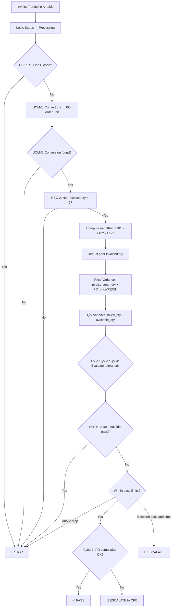

# 🛡️ PolicyGuard AP — Project Architecture

## Monorepo Structure

```
Track_A2__Three_Way_Match/
├── backend/                          # Python FastAPI backend
│   ├── .env.example                  # Environment variable template
│   ├── config.py                     # Centralised config from .env
│   ├── main.py                       # FastAPI app + all API routes
│   ├── requirements.txt              # Python dependencies (all free)
│   ├── models/
│   │   └── schemas.py                # Pydantic domain models & API schemas
│   ├── routers/                      # (Future: split routes)
│   └── services/
│       ├── airtable_client.py        # Typed pyairtable wrapper (7 tables)
│       ├── matching_engine.py        # 🧠 Core 3-way match (100% deterministic)
│       ├── audit_logger.py           # SQLite immutable audit trail
│       ├── slack_service.py          # Block Kit cards + interactive callbacks
│       └── gemini_service.py         # PDF extraction + variance explanations
│
├── frontend/                         # React + Vite + Tailwind Ops Console
│   ├── package.json
│   ├── vite.config.js                # Proxies /api → localhost:8000
│   ├── tailwind.config.js
│   └── src/
│       ├── App.jsx                   # Tab shell (Dashboard, Upload, Audit)
│       └── pages/
│           ├── Dashboard.jsx         # Parked invoices list + process triggers
│           ├── UploadPDF.jsx         # PDF upload → Gemini extraction
│           └── AuditLogs.jsx         # Searchable audit trail viewer
│
├── data/                             # Read-only reference + local audit DB
│   ├── Variance_Policy.md            # FIN-AP-07 v3.2 (source of truth)
│   ├── vendor_master.csv             # Vendor reference data
│   ├── RSEG_Prior_Invoiced.csv       # Prior invoiced quantities
│   ├── uploads/                      # Uploaded PDF staging (auto-created)
│   └── audit.db                      # SQLite audit trail (auto-created)
│
└── dataset/                          # Original hackathon data (read-only)
```

## API Endpoints

| Method | Path | Purpose |
|--------|------|---------|
| `POST` | `/api/invoices/process/{doc_num}` | Run 3-way match for one parked invoice |
| `POST` | `/api/invoices/process-all` | Batch-process all parked invoices (GEN-2 order) |
| `POST` | `/api/invoices/upload-pdf` | Upload PDF → Gemini extraction → match |
| `POST` | `/api/slack/interact` | Slack Approve/Reject callback handler |
| `GET`  | `/api/invoices/parked` | List all parked invoices from Airtable |
| `GET`  | `/api/audit-logs` | Query audit trail (filterable) |
| `GET`  | `/api/health` | Health check |

## Matching Engine Pipeline



## Airtable Table Mapping

| Airtable Table | SAP Origin | Column Style | Purpose |
|----------------|-----------|--------------|---------|
| `invoice_header` | RBKP | plain names | Parked invoices (the trigger) |
| `invoice_line` | RSEG | plain names | Invoice line items |
| `po_header` | EKKO | plain names | PO headers |
| `po_line` | EKPO | plain names | PO line items |
| `goods_receipt` | MSEG | plain names | GRN with movement types |
| `material` | MARA | plain names | Material master + category |
| `unit_conversion` | MARM | plain names | Material-specific UoM factors |
| `approver_matrix` | Custom | plain names | Escalation routing rules |
| `prior_invoice` | RSEG prior | plain names | Already-posted invoices |

## Next Steps

> [!IMPORTANT]
> Before running the backend, you need to:
> 1. Copy `.env.example` → `.env` and fill in your real API keys
> 2. `cd backend && pip install -r requirements.txt`
> 3. `cd frontend && pnpm install`

Then:
```bash
# Terminal 1 — Backend
cd backend && uvicorn main:app --reload --port 8000

# Terminal 2 — Frontend
cd frontend && pnpm dev
```
